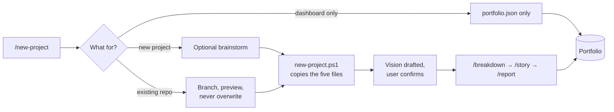

# PMO Project Standardization

**A PMO-style project standard for AI-assisted software development: every
project is planned, built, tested, secured and reported the same way,
whether a person or an AI coding agent is doing the work.**

AI coding agents (Claude Code, Codex and others) can write a lot of code
fast, but on their own they skip the parts a project office cares about: a
clear scope, recorded decisions, tests, security and cost. Each project
ends up documented differently, or not at all, so nobody can compare them
or report on them.

This repo is the fix: one written standard, kept here, and a one-command
setup that puts any new or existing repo on it. Each project carries only
what is specific to it, plus a line saying which version of the standard
it follows.

**Status:** v2 (current version in [`CHANGELOG.md`](CHANGELOG.md)). Next:
roll the standard out across existing repos and build a portfolio health
dashboard ([roadmap](#roadmap)).

---

## The problem it solves

| Without a standard | With this standard |
|---|---|
| Each repo has its own (or no) docs | The same few files in every repo, in the same places |
| Scope lives in someone's head | Vision → Epic → Feature → Story with IDs and one Definition of Done |
| "Why did we do it this way?" is lost | Trade-offs logged as decision records, with the options considered |
| The AI agent picks its own process | The agent follows written rules: test-first, simplest code, the user decides, no cost without a decision |
| Status means asking around | A machine-readable `portfolio.json` in every repo, kept current by the agent, with judgment calls from a person |
| Every repo has its own copy of the rules, drifting apart | The rules live once, versioned; a repo pins the version it follows |

## How it's built

**1. The standard (`standard/`)**: the rules, written once.

| File | Covers |
|---|---|
| `requirements.md` | Epics, features, stories, phases, the Definition of Done, NFRs, bugs |
| `decisions.md` | When a choice needs options compared, and how it's logged |
| `coding.md` | Simplicity, files, comments, errors, logging, encoding |
| `testing.md` | Test-first, no weakening tests, regression tests for bugs, checklists |
| `git.md` | One branch per story, Conventional Commits, the user merges; local or GitHub |
| `security.md` | Secrets, dependencies, input, privacy, AI-agent risks, threat model |
| `sessions.md` | Working with an agent, handoffs between sessions, reporting |
| `accessibility.md`, `cost.md` | For projects with a UI, or that cost money |

Versioned by git tag: a project on v2.0.0 always reads the v2.0.0 rules, so
a change to the standard never changes a project's rules by surprise.

**2. What a project holds**: five files, about 120 lines to start.

| File | Holds |
|---|---|
| `AGENTS.md` | What it is, the standard version, hosting, commands, seven core rules, project-specific notes |
| `portfolio.json` | Status for the portfolio: owner, sponsor, program, lifecycle, health, phase, progress, risks, blockers, call-outs, budget ([contract](spec/reporting-contract.md)) |
| `docs/requirements.md` | Vision, phases, epics, features, stories, NFRs, bugs |
| `docs/decisions.md` | Decision records |
| `docs/session-log.md` | Handoff notes between sessions |

Extra docs (security, accessibility, architecture, budget, manual tests)
are added only when the project grows into them.

**3. Workflow commands** for Claude Code, installed once per machine, used
in every project:

| Command | What it does |
|---|---|
| `/new-project` | Start a project, put an existing repo on the standard, or add only `portfolio.json` |
| `/brainstorm` | Explore an idea and compare directions before anything is built |
| `/breakdown` | Turn the vision into phases, epics, features and stories |
| `/stack` | Recommend a tech stack with 2–3 options; the user decides |
| `/decide` | Compare options for a design choice and log the decision |
| `/story` | Build a story (or a whole feature) test-first on its own branch, then check the Definition of Done |
| `/fix-bug` | Log a bug, reproduce it with a failing test, then fix it |
| `/report` | Update `portfolio.json`: counts from the docs, health and risks from the user |
| `/security-check`, `/a11y-check` | Run the security and accessibility checklists |
| `/wrap-up` | End-of-session handoff: session log, time spent, anything unfinished |

Every command first checks that the repo is on the standard and reads the
rules at the repo's version ([`skills/preflight.md`](skills/preflight.md)).

## How it works



- **New project:** a few questions, the files, a one-paragraph vision the
  user confirms, then `/breakdown` and `/stack`.
- **Existing repo:** works on a branch and opens a PR. Only missing files
  are added; the existing stack is recorded, not replaced; no stories are
  written for code that already exists. A repo with a `CLAUDE.md` gets one
  line, `@AGENTS.md`, so Claude Code loads the standard, and only with the
  user's yes.
- **Dashboard only:** adds `portfolio.json` and nothing else, for repos
  (like course exercises) that should be visible but don't need the rest.
- **Hosting:** each project is `local` or `github`. Local projects keep the
  branch-per-story discipline without pushes or PRs.

## Design decisions

Recorded with their options in [`DECISIONS.md`](DECISIONS.md).

- **Shared standard, small footprint (v2).** v1 copied 33 files and about
  2,300 lines into every repo, and adoption stalled at 2 repos. v2 keeps
  the rules here and gives each repo about 5 files.
- **The user decides.** Every significant choice offers 2–3 options
  including the simplest, and the decision is logged.
- **Language-neutral.** The standard contains no code; the agent
  recommends a stack per project.
- **Agent-agnostic.** `AGENTS.md`, not a tool-specific file, so the
  standard isn't tied to one AI vendor.
- **Additive on existing repos.** The standard covers docs and process,
  not code layout, so adopting it never restructures working code.

## Quality

- `tests/check-template.ps1` generates a new project, an existing-repo
  adoption and a dashboard-only repo, then checks: the right files, no
  unfilled placeholders, links resolve, existing files untouched, every
  command has valid metadata and runs the preflight, the installer works,
  every file is valid UTF-8, and new projects pass every required
  compliance check.
- `check-compliance.ps1` rates any repo against the standard (Not on
  standard, Reporting, Adopted, Current) by evidence in the repo, using the
  checks in [`spec/compliance-checks.json`](spec/compliance-checks.json).
- Every change goes through a branch and pull request; releases are tagged
  and listed in [`CHANGELOG.md`](CHANGELOG.md).

## Roadmap

Done: the reporting contract and compliance spec (v1.3–v1.4), and v2's
shared standard (v2.0.0).

1. **Roll the standard out.** Move every active repo onto the standard,
   and give course and learning repos `portfolio.json` only.
   ([notes](ideas/standardize-repos.md))
2. **Portfolio health dashboard.** A separate project, built on this
   standard, where a portfolio manager reviews every repo by program:
   health, owner, progress, risks, call-outs, budget and compliance.
   ([notes](ideas/portfolio-reporting.md))
3. **Governance extensions** once real projects need them: expanded
   security, legal and website-launch checklists ([ideas/](ideas/)).

---

## Repository layout

| Path | What it is |
|---|---|
| `standard/` | The rules ([`standard/README.md`](standard/README.md)). |
| `scaffold/` | The starter files a project gets, plus `README.md` and `.gitignore` for new repos. `scaffold/extras/` holds the extra docs. |
| `skills/` | The workflow commands, and `preflight.md`, which every command runs first. |
| `new-project.ps1` | Copies `scaffold/` (not the extras) to a new folder, fills in the name, hosting (`-Hosting local\|github`, default local) and standard version, and runs `git init`. `-IntoExisting` adopts the standard in a repo you already cloned; `-ReportOnly` adds only `portfolio.json`. Both never overwrite; `-DryRun` previews. |
| `install-skills.ps1` | Links every command in `skills/` into `%USERPROFILE%\.claude\skills\`. Never overwrites; `-DryRun` previews. |
| `check-compliance.ps1` | Rates a local repo against the standard: each check, the level, warnings. Read-only. |
| `spec/` | For tools that read projects on the standard: the reporting contract, the `portfolio.json` JSON Schema, and the compliance spec and checks. |
| `tests/check-template.ps1` | Automated checks (see [Quality](#quality)). Run before every PR. |
| `DECISIONS.md` | Design decisions about the standard itself. |
| `ideas/` | Ideas captured for later. |
| `CHANGELOG.md` | What changed in each version (git tags). v1's full per-project template is at tag `v1.5.1`. |

## Quick start

**1. Install the commands** (once per machine, from this folder):

```powershell
.\install-skills.ps1 -DryRun   # see what it would link
.\install-skills.ps1
```

Each command becomes a junction (folder shortcut) to this repo, so a change
here reaches every project at once. Existing names are never overwritten.

**2. Start or adopt a project:** in Claude Code, from any folder, type
`/new-project` and answer the questions.

**Or by hand (PowerShell):**

```powershell
.\new-project.ps1 -Name "Guess Game"
# creates guess-game in the current folder; add -Destination to put it elsewhere

.\new-project.ps1 -Name "my-repo" -Destination D:\Projects -IntoExisting -Hosting github -DryRun
# previews adopting the standard in an existing clone at D:\Projects\my-repo

.\new-project.ps1 -Name "my-repo" -Destination D:\Projects -ReportOnly
# adds only portfolio.json, so the repo shows on the dashboard
```

If PowerShell blocks scripts:
`powershell -ExecutionPolicy Bypass -File .\new-project.ps1 -Name "Guess Game"`

### Moving a project to a newer version

Read the [`CHANGELOG.md`](CHANGELOG.md) entries since the project's
version: each says what a project must do, if anything. Make those changes
on a branch, update the `**Standard:**` line in `AGENTS.md`, run
`check-compliance.ps1`, and open a PR.

### Changing the standard

Edit `standard/`, `scaffold/` or `skills/`, run `tests/check-template.ps1`,
add a CHANGELOG entry, and open a PR (rules in
[`standard/README.md`](standard/README.md) → Changing the standard).
