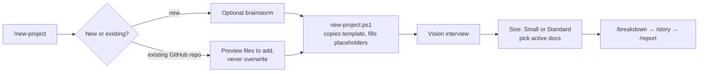

# PMO Project Standardization

**A PMO-style project standard for AI-assisted software development:
every project starts with the same documents, workflow and quality gates,
whether a person or an AI coding agent is doing the work.**

AI coding agents (Claude Code, Codex and others) can write a lot of code
fast, but on their own they skip the parts a project office cares about:
a clear scope, recorded decisions, tests, security and cost. Each project
ends up documented differently, or not at all, so nobody can compare them
or report on them.

This repo is the fix: a reusable project template plus a one-command setup
that gives every new or existing repo the same structure. The agent is
told, in writing, how to plan, build, test and report, and the project
records it all in predictable places.

**Status:** in use for new projects (current version in
[`CHANGELOG.md`](CHANGELOG.md)). Next phase: roll the standard out across
existing repos and build a portfolio health dashboard
([roadmap](#roadmap)).

---

## The problem it solves

| Without a standard | With this template |
|---|---|
| Each repo has its own (or no) docs | Same 17 docs in the same order in every repo |
| Scope lives in someone's head | Vision → Epic → Feature → Story with IDs and a Definition of Done |
| "Why did we do it this way?" is lost | Trade-offs logged as decision records with the options considered |
| The AI agent picks its own process | `AGENTS.md` gives the agent the rules: test-first, simplest code, ask before adding cost |
| Status means asking around | Status report, session log and plan (Gantt) in known files, plus a machine-readable `portfolio.json` per repo |
| Security, accessibility and budget come up late | Each has a checklist doc and a command from day one |

## What every project gets

**1. A documented lifecycle (`project-template/docs/`)**

| Phase | Documents |
|---|---|
| Initiate | `00-vision` |
| Plan | `01-requirements` (epics, features, stories, NFRs), `02-architecture`, `03-tech-stack`, `04-project-plan` (Mermaid Gantt) |
| Execute | `05-decisions-log` (ADRs), `06-coding-conventions`, `07-testing-checklist`, `12-manual-tests`, `13-git-workflow` |
| Monitor | `09-status-report`, `10-session-log`, `16-budget` (money and hours) |
| Govern | `14-security` (threat model lite), `15-accessibility` (WCAG 2.2 AA), `11-glossary`, `08-prompt-log` |

Projects are **right-sized**: a short interview classifies a project as
Small or Standard, and docs it doesn't need become marked one-line stubs
(never deleted, so references stay valid and the doc can be switched on
later).

**2. Rules for the AI agent (`AGENTS.md`)**

One file the agent reads at the start of every session: the current phase,
which docs are active, architecture rules it must not break, and how to
work: test-first, one branch and PR per story, Conventional Commits with
story IDs, no new dependency or cost without a logged decision.

**3. A portfolio report card (`portfolio.json`)**

What the project reports upward, in a fixed format any tool can read:
owner, sponsor, program, lifecycle, health (🟢/🟡/🔴), phase, progress,
risks, blockers, call-outs for leadership, and budget. `/report` and
`/wrap-up` keep it current, and judgment calls (health, risks, call-outs)
always come from a person. Contract and JSON Schema:
[`spec/`](spec/reporting-contract.md).

**4. Repeatable workflow commands (`.claude/skills/`)**

| Command | What it does |
|---|---|
| `/brainstorm` | Explore an idea and compare options before anything is built |
| `/breakdown` | Turn the vision into epics, features and stories |
| `/stack` | Recommend a tech stack with 2–3 options; the user decides |
| `/decide` | Record a design decision with the options table |
| `/story` | Build a story test-first on its own branch, then check the Definition of Done |
| `/fix-bug` | Log a bug with an ID, reproduce it with a failing test, then fix it |
| `/report` | Write a status report from the docs |
| `/security-check`, `/a11y-check` | Run the security and accessibility checklists |
| `/wrap-up` | End-of-session handoff: session log, time spent, anything unfinished |

## How it works



- **New project:** `/new-project` (a Claude Code command) asks a few
  questions, runs `new-project.ps1`, interviews the user for the vision, and
  sizes the project.
- **Existing repo:** picks a repo from GitHub, clones it, previews which
  files would be added, then adds the template on its own branch. It
  records the existing stack instead of proposing a new one.
- **Hosting:** each project is `local` or `github`. Local projects get the
  same branch-per-story discipline without pushes or PRs.

## Design decisions

- **Language-neutral.** The template contains no code; the agent recommends
  a stack per project and the user decides.
- **Simplest thing that works.** Every trade-off offers 2–3 options
  including the simplest, and the choice is logged.
- **Sized by scope, not calendar time.** With AI-assisted coding, duration
  says little; sizing asks what the project touches (phases, network,
  secrets, personal data).
- **Agent-agnostic instructions.** `AGENTS.md`, not a tool-specific file,
  so the standard isn't tied to one AI vendor.
- **Additive on existing repos.** The standard covers docs and
  conventions, not code layout, so adopting it never restructures working
  code.

## Quality

- `tests/check-template.ps1` generates a fresh project and an
  existing-repo install, then checks: no unfilled placeholders, every link
  and doc reference resolves, every command has valid metadata, duplicated
  instructions stay in sync, and every file is valid UTF-8.
- Every change goes through a branch and pull request; releases are tagged
  and listed in [`CHANGELOG.md`](CHANGELOG.md).

## Roadmap

Done: version stamp in every new project (v1.2.0) and the reporting
contract, `portfolio.json` (v1.3.0).

1. **Compliance spec.** Written rules for when a repo counts as adopted,
   versioned and current, including which template changes are required.
2. **Standardize existing repos.** Inventory all repos, pilot the
   template on 2–3, feed what's learned back in.
   ([notes](ideas/standardize-repos.md))
3. **Portfolio health dashboard.** A separate project, built on this
   standard, where a portfolio manager reviews every repo: health, owner,
   risks, call-outs, budget and compliance.
   ([notes](ideas/portfolio-reporting.md))
4. **Governance extensions** once real projects need them: expanded
   security, legal/compliance and website-launch checklists
   ([ideas/](ideas/)).

---

## Repository layout

| Path | What it is |
|---|---|
| `project-template/` | The template. Everything in it is copied into each new project: docs, `AGENTS.md`, workflow commands (`.claude/skills/`), PR template, `.gitignore`. |
| `new-project.ps1` | Copies `project-template` to a new folder, fills in the name and hosting (`-Hosting local\|github`, default local), runs `git init` on `main`. `-IntoExisting` adds the template to a repo you already cloned; `-DryRun` previews. |
| `skills/new-project/` | Source of the `/new-project` Claude Code command (user level). |
| `tests/check-template.ps1` | Automated check of the template (see [Quality](#quality)). Run it before opening a PR. |
| `spec/` | Specs for tools that read projects built on the standard: the reporting contract and `portfolio.json` JSON Schema. Not copied into projects. |
| `ideas/` | Ideas captured for later (not part of the template). |
| `CHANGELOG.md` | What changed in each version (git tags `v1.0.0`, ...). |

## Quick start

**Recommended:** in Claude Code, from any folder, type `/new-project` and
answer the questions.

**Or by hand (PowerShell):**

```powershell
.\new-project.ps1 -Name "Guess Game"
# creates guess-game in the current folder; add -Destination to put it elsewhere
```

If PowerShell blocks scripts:
`powershell -ExecutionPolicy Bypass -File .\new-project.ps1 -Name "Guess Game"`

Then start Claude Code inside the new folder and run `/breakdown`.

### Installing the `/new-project` command

Claude Code finds user-level commands in `%USERPROFILE%\.claude\skills\`.
Point a **junction** (folder shortcut) there at this repo, so edits to
`skills/new-project/SKILL.md` take effect immediately:

```powershell
New-Item -ItemType Junction -Path "$env:USERPROFILE\.claude\skills\new-project" -Target "<path-to-this-repo>\skills\new-project"
```

### Changing the template

Edit files in `project-template/`, run `tests/check-template.ps1`, and open
a PR. Changes apply to projects created afterwards; existing projects keep
their copy.
