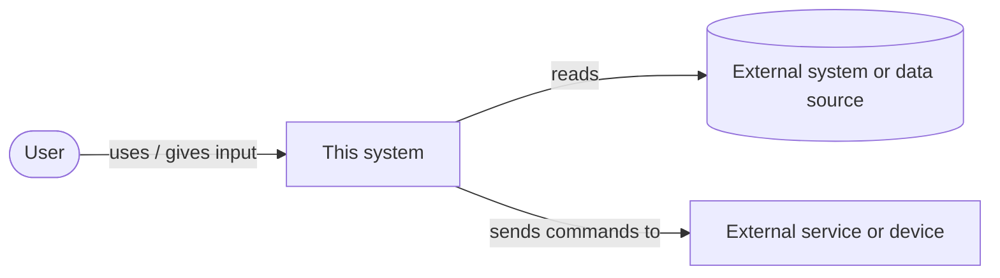
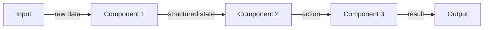
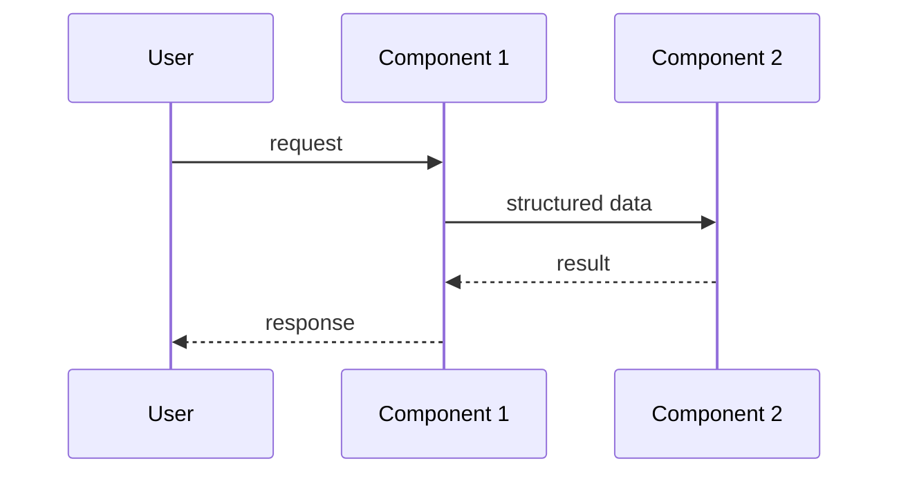
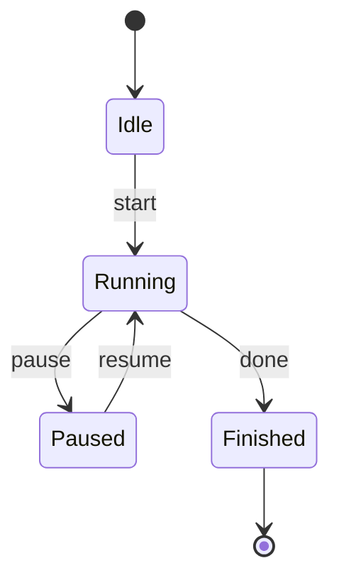
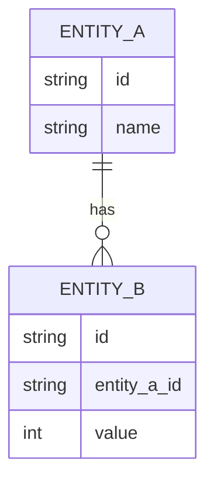

# Architecture

## Diagrams in this doc

Diagrams are written in **Mermaid** — plain text that renders as a picture
on GitHub and in VS Code (with the "Markdown Preview Mermaid Support"
extension). Being text, they live next to the docs they illustrate and
AI agents can update them in the same change as the code.

Zoom levels follow the **C4 model**: start wide, then zoom in.

| Diagram | Shows | Include |
|---|---|---|
| **System context** | The system as one box, the people who use it, and the external systems it talks to | Always |
| **Components** | The parts inside the system and the data passed between them | Always |
| **Sequence** | The order of calls/messages in one important flow | When a flow has several steps across components, or timing matters |
| **State** | The states something moves through, and what triggers each change | When something has modes (e.g. menu → playing → game over, draft → published) |
| **Data model** | Stored data: entities, fields, relationships | When the project stores data (files or database) |

Rules:
- Delete the example diagrams that don't apply — don't leave empty ones.
- Keep each diagram small: around 10 boxes at most. If it's bigger, split
  it or zoom out a level.
- Label arrows with *what* moves along them (data, call, event).
- **Diagrams must match the code.** Update them in the same change that
  alters components, interfaces, flows, states, or stored data. A wrong
  diagram is worse than none.
- Use plain words in labels — avoid `<`, `>`, and quotes inside labels;
  they can break rendering.

## Overview

<One paragraph: how the system runs at the highest level — a loop, a
request/response server, a batch pipeline, a UI app — and what state, if
any, persists between runs.>

### System context

Who and what the system interacts with. The example below is a
placeholder — replace every label.

### Components

The parts inside the system and what passes between them. Each box should
match a section under Components below and a folder in
`06-coding-conventions.md`.

### Key flow — sequence (if applicable)

One important flow, step by step. Add one diagram per flow worth showing.

### States (if applicable)

### Data model (if applicable)

## Components

### <Component 1>
<What it does, what it takes in, what it returns. Candidate libraries and a
pointer to `03-tech-stack.md` for the tradeoff.>

### <Component 2>
<...>

### <Component 3>
<...>

## Data flow contract

Keep the interfaces between components explicit so each one can be tested in
isolation:

- **<Component 1> → <Component 2>:** <data shape>
- **<Component 2> → <Component 3>:** <data shape — define the exact schema
  here once it settles>

## Design options and trade-offs

Most design choices are small and easy to change later — just pick the
simplest option and move on. A choice gets a **formal comparison** when any
of these is true:

- it's hard or expensive to reverse (data format, language, storage,
  framework, an external service)
- it affects more than one component, or the interfaces between them
- there are two or more genuinely viable options and the right one isn't
  obvious

For those, the process is:

1. **List the options** — usually 2-3, always including the simplest one
   that could work.
2. **Compare them** against criteria that come from `00-vision.md` (goals,
   constraints) — e.g. simplicity, effort, performance, cost, how easy it
   is to change later, fit with skills you have.
3. **Recommend one**, with the trade-off you'd be accepting.
4. **The user decides.** Log the full comparison and the decision in
   `05-decisions-log.md` (its template has the options table).
5. **Summarise it here** in the table below, and update the design sections
   above to match.

### Open design questions

Choices that need a comparison but haven't been decided yet. Each should
also exist as a `Proposed` entry in `05-decisions-log.md`.

- <question — e.g. "How should run results be stored?"> → decide by <phase
  or trigger>

### Key decisions

The chosen option for each significant design question — details,
rejected options and reasoning are in the linked log entry.

| Area | Chosen | Main alternative rejected | Trade-off accepted | Decision |
|---|---|---|---|---|
| <e.g. Storage> | <e.g. JSON files> | <e.g. SQLite> | <e.g. no querying across runs> | <link to `05-decisions-log.md` entry> |

## Non-goals

- <Things this system deliberately does not do, with a pointer to the
  decision in `05-decisions-log.md` where relevant>
