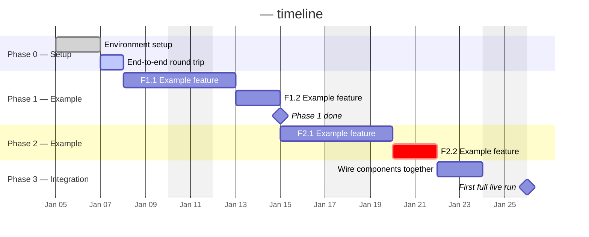

# Project plan

<One line restating the goal.> See `02-architecture.md` for how the phases
below map to system components.

This doc is about *when*; `01-requirements.md` is about *what*. Each phase
lists the features/stories it delivers by ID, plus any setup tasks that
aren't stories.

Each phase has a goal, a task list, and exit criteria. A phase is done when
its exit criteria are met and the "before marking a phase done" section of
`07-testing-checklist.md` passes — not when the tasks are ticked.

## Phase 0 — Environment setup
**Estimate:** <e.g. 1-2 days>
**Goal:** Prove the toolchain and the riskiest integration work end-to-end,
with no real logic yet.

- [ ] Choose and record the stack (`AGENTS.md` → Choosing the stack)
- [ ] Set up the environment and dependencies
- [ ] <Smallest possible end-to-end round trip through the riskiest part>
- [ ] Create the test folders (`07-testing-checklist.md` → Kinds of tests)
      and run one passing test from the test runner
- [ ] Fill in `AGENTS.md` → Commands (run, test, coverage, lint, format)
- [ ] Make the first commit on `main` (`13-git-workflow.md`)
- [ ] *GitHub only (n/a if `Hosting: local`):* create the GitHub repo, push
      `main`, and (optionally) protect `main` (`13-git-workflow.md`)
- [ ] *GitHub only (n/a if `Hosting: local`):* turn on Dependabot and
      secret scanning (`14-security.md` → GitHub setup)
- [ ] Copy `.env.example` to `.env` if the project needs secrets
- [ ] First pass of the threat model (`14-security.md`)
- [ ] Decide whether accessibility applies and trim `15-accessibility.md`
- [ ] Set budget limits and provider spend alerts (`16-budget.md`)
- [ ] Fill in the non-functional requirements (`01-requirements.md`)
- [ ] <Measure the one number that matters, if any (speed, latency, size)>

**Exit criteria:** <What you can demonstrate, reliably.>

## Phase 1 — <name>
**Estimate:** <days>
**Goal:** <one sentence>
**Delivers:** <feature IDs, e.g. F1.1, F1.2>

- [ ] S1.1.1 — <story title>
- [ ] S1.1.2 — <story title>
- [ ] <setup task that isn't a story>

**Exit criteria:** <observable, testable outcome>

## Phase 2 — <name>
**Estimate:** <days>
**Goal:** <one sentence>

- [ ] <task>
- [ ] <task>

**Exit criteria:** <observable, testable outcome>

## Phase 3 — Integration
**Estimate:** <days>
**Goal:** Wire the components together and run the whole thing for real.

- [ ] <task>
- [ ] <task>

**Exit criteria:** <e.g. runs unattended for a full session without crashing>

## Phase 4 — Tuning and iteration
**Estimate:** Ongoing
**Goal:** <what "better" means for this project>

- [ ] <task>

**Exit criteria:** None — this phase is iterative and ongoing.

## Status

Fill in planned dates when the plan is made; fill in actual dates as phases
start and finish. Never overwrite the planned dates — the gap between
planned and actual is what makes estimates better next time.

| Phase | Status | Planned start | Planned end | Actual start | Actual end |
|---|---|---|---|---|---|
| 0 — Environment setup | Not started | YYYY-MM-DD | YYYY-MM-DD | | |
| 1 — <name> | Not started | YYYY-MM-DD | YYYY-MM-DD | | |
| 2 — <name> | Not started | YYYY-MM-DD | YYYY-MM-DD | | |
| 3 — Integration | Not started | YYYY-MM-DD | YYYY-MM-DD | | |
| 4 — Tuning | Not started | YYYY-MM-DD | Ongoing | | |

**Statuses:** `Not started` · `In progress` · `Done` · `Blocked`

## Timeline

Gantt chart of the plan, by phase and feature. Written in Mermaid, so it
renders on GitHub and in VS Code's Markdown preview (with the "Markdown
Preview Mermaid Support" extension).

How to maintain it:
- One `section` per phase, one bar per feature (use its ID from
  `01-requirements.md`) or setup task.
- Mark bars `done` or `active` as work progresses; add `crit` to anything
  on the critical path or running late.
- Use `after <id>` for dependencies so later bars shift automatically when
  an earlier one moves.
- The dates and names below are examples — replace them all.

