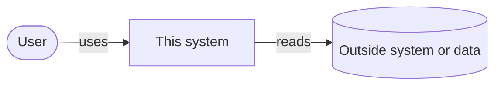
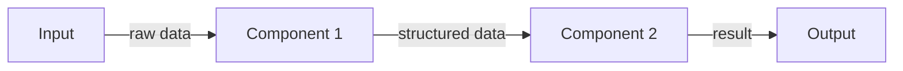

# Architecture

How the system is put together. Rules for this file and its diagrams: the
standard's `decisions.md` → Architecture docs and diagrams. Diagrams must
match the code: update them in the same change.

## Overview

<One paragraph: how the system runs (a loop, a server, a batch job, an
app) and what persists between runs.>

### System context

### Components

## Components

### <Component 1>

<What it does, what it takes in, what it returns.>

## Interfaces

- **<Component 1> → <Component 2>:** <data shape, exact once it settles>

## Key decisions

| Area | Chosen | Main alternative rejected | Trade-off accepted | Decision |
|---|---|---|---|---|
| <e.g. Storage> | <e.g. JSON files> | <e.g. SQLite> | <e.g. no queries across runs> | <entry in `docs/decisions.md`> |
